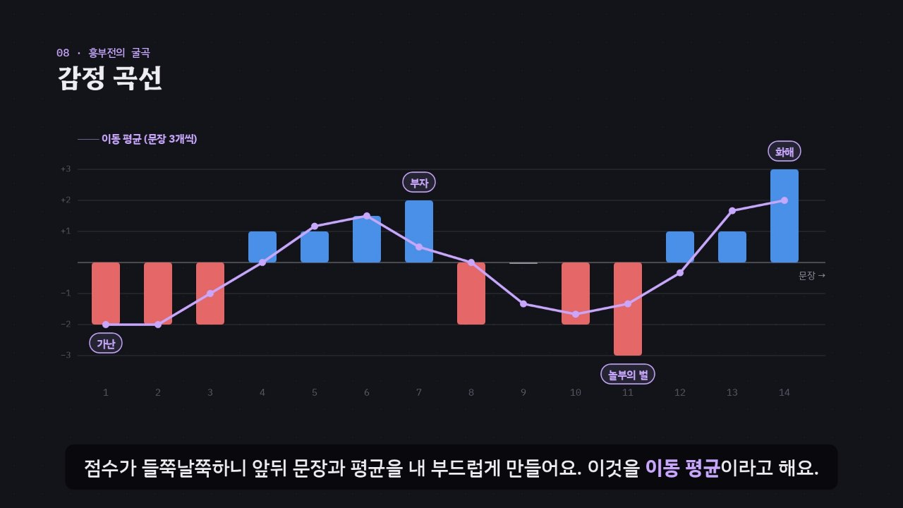

# 글에 담긴 마음 — 감정분석의 기본 원리와 방법

> [DH 튜토리얼](../README.md) 모음의 한 꼭지입니다. 사이트 주소: `https://vadoro.github.io/dh_tutorials/sentiment-analysis/`

글에 담긴 감정이 긍정인지 부정인지, 얼마나 강한지 숫자로 재는 **감정분석**(sentiment analysis)의 기본 원리와 세 가지 방법을 약 5분 30초짜리 인터랙티브 모션그래픽으로 설명합니다.

- **감성 사전**: 단어마다 점수를 매겨 두고 더하기
- **규칙**: 부정어 · 강조어 · 대조
- **기계학습**: 나이브 베이즈로 데이터에서 낱말의 무게 배우기

시험 데이터로 정확도를 재는 법, 언어 모델의 특징, 흥부전으로 그리는 **감정 곡선**까지 다뤄요.



## 바로 보기

| 방법 | 설명 |
| --- | --- |
| **웹 주소** | `https://vadoro.github.io/dh_tutorials/sentiment-analysis/` |
| **`index.html` 더블클릭** | 저장소를 내려받아 `sentiment-analysis/index.html`을 열면 끝. 설치도, 서버도 필요 없어요. 인터넷이 없으면 글꼴만 기본 한글 글꼴로 바뀌어요. |
| **MP4 영상** | [`video/sentiment-analysis.mp4`](video/sentiment-analysis.mp4) — 1080p, 자막 포함, 장(chapter) 표시. 자막 원고는 [`video/sentiment-analysis.srt`](video/sentiment-analysis.srt). |

## 무엇을 배우나요

| 장 | 시각 | 내용 | 직접 해 보기 |
| --- | --- | --- | --- |
| 00 들어가며 | 0:00 | 서평·일기·소설 속 마음, 감정분석으로 하는 일, 오늘 볼 세 방법 | 카드를 골라 점수 풀이 보기 |
| 01 감정분석이란 | 0:20 | 긍정·부정·중립과 −1~+1 점수, 감정의 종류, 분석 단위, ‘느끼는’ 것이 아니라 ‘추정’ | 내 문장이 눈금 어디쯤인지 |
| 02 감성 사전 | 0:46 | 단어마다 점수, 사전에 있는 단어 찾아 더하기, 사전에 없으면 0, 합의 부호로 나누기 | 이 튜토리얼의 사전 표 |
| 03 규칙 더하기 | 1:24 | 부정어(×−1), 강조어(×1.5)·약화어(×0.5), 대조(‘하지만’·‘~지만’ 앞 ×0.5, 뒤 ×1.5), VADER | 규칙을 끄고 켜 보기 |
| 04 사전의 한계 | 2:08 | 새말(꿀잼), 분야(서평 속 ‘눈물’), 비꼼(참 잘하는 짓이다) | 사전에 단어 더하기 |
| 05 데이터로 배우기 | 2:36 | 학습 데이터, 긍정·부정 서평 12개씩, 낱말 횟수, 나이브 베이즈의 무게, 라플라스 스무딩 | 낱말을 골라 무게 계산 따라가기 |
| 06 예측과 평가 | 3:16 | 무게를 더해 예측, 시험 데이터 8개, 정확도 75%와 87.5%, 두 방법이 틀리는 곳 | 시험 서평 하나씩 보기 |
| 07 문맥을 읽는 모델 | 3:56 | BERT 같은 언어 모델, NSMC, 설명하기 어려움과 무거운 계산, 사람이 표시한 자료와 비교 | 더 알아볼 자료 |
| 08 감정 곡선 | 4:22 | 흥부전 문장 14개의 점수, 이동 평균, 이야기의 기본 모양, 곡선은 길잡이 | 창 크기 바꾸기, 문장 고르기 |
| 09 정리 | 5:04 | 다섯 단계 정리, 파이썬 코드 | 내 글로 해 보기 |

영상 아래에는 세 가지가 더 있어요.

- **놀이터** — 내 문장을 쓰면 감성 사전 + 규칙과 나이브 베이즈가 각각 점수를 매기고 근거(어절마다 점수, 낱말마다 무게)를 보여 줘요.
  - 규칙 세 가지를 끄고 켜거나, `꿀잼 +2, 눈물 0`처럼 사전에 단어를 더할 수 있어요.
  - 이야기를 붙여 넣으면 감정 곡선과 이동 평균을 그려요.
  - 학습·시험 데이터를 고치면 정확도, 혼동 행렬, 낱말의 무게를 바로 다시 계산해요.
  - 지금 설정과 같은 값을 내는 파이썬 코드도 보여 줘요.
- **퀴즈** — 열 문제. 점수가 가장 낮은 문장 고르기, 감정 곡선에서 장면 고르기 같은 그림 문제가 섞여 있고, 답은 페이지의 계산으로 정해요.
- **용어집** — 기본 용어, 사전과 규칙, 기계학습, 언어 모델과 감정 곡선.

### 플레이어 조작

| 키 | 동작 |
| --- | --- |
| 스페이스 | 재생 / 일시정지 |
| ← → | 5초 뒤로 / 앞으로 |
| Shift + ← → | 이전 장 / 다음 장 |
| C | 자막 켜기 / 끄기 |
| V | 음성 해설 켜기 / 끄기 (자막을 다 읽을 때까지 영상이 기다려요) |
| F | 전체 화면 |

- 화면을 누르면 그 대상을 더 자세히 볼 수 있어요. 조작하면 영상이 멈추고, 재생하면 이어서 봐요.
  - 들어가며의 카드: 그 문장의 점수 풀이
  - 예측과 평가의 시험 서평 줄: 두 방법의 근거
  - 감정 곡선의 막대: 그 문장의 점수
- ‘직접 해 보기’에서 끈 규칙과 더한 단어는 영상 장면과 놀이터에 함께 적용돼요.
- 주소 끝에 `#c-장면이름`을 붙이면 그 장면에서 시작해요. 예: `index.html#c-arc`

## 예시 데이터와 결과

학습 서평 24개(긍정 12, 부정 12), 시험 서평 8개로 계산한 값입니다.

| 시험 서평 | 실제 | 감성 사전 + 규칙 | 나이브 베이즈 (긍정일 확률) |
| --- | --- | --- | --- |
| 꿀잼! 하루 만에 다 읽었다 | 긍정 | 0 중립 ✗ (새말) | 85% ✓ |
| 읽는 내내 눈물이 났다 | 긍정 | −1 부정 ✗ (분야) | 85% ✓ |
| 따뜻하고 아름다운 이야기 | 긍정 | ✓ | ✓ |
| 번역도 매끄럽고 정말 재미있다 | 긍정 | ✓ | ✓ |
| 노잼. 돈이 아깝다 | 부정 | ✓ | ✓ |
| 문장은 아름답지만 이야기는 지루하다 | 부정 | −1 ✓ (대조 규칙) | 65% ✗ (순서를 모름) |
| 추천하지 않는다 | 부정 | −1 ✓ (부정어 규칙) | ✓ |
| 뻔한 결말에 실망했다 | 부정 | ✓ | ✓ |
| **정확도** | | **6/8 = 75%** | **7/8 = 87.5%** |

- 나이브 베이즈는 라플라스 스무딩(α = 1)을 쓰고, 어휘는 48개예요.
- 낱말의 무게(ln P(낱말|긍정) − ln P(낱말|부정)): 없다 +1.36, 눈물 +1.08, 꿀잼 +1.08, 아깝다 −1.12, 않다 −1.12.
  - ‘지루할 틈이 없다’의 ‘없다’가 긍정 무게를 받았어요. 단어 가방이 문맥을 모르는 예예요. 놀이터에서 이 서평을 지우면 결과가 바뀌어요.
- 흥부전 문장 14개의 사전 점수: −2, −2, −2, +1, +1, +1.5, +2, −2, 0, −2, −3, +1, +1, +3.
  - 이동 평균(창 3)으로 보면 가난 → 부자 → 놀부의 벌 → 화해의 굴곡이 보여요.

## 무엇이 진짜 계산인가요

- **실제로 계산**: 다음 값은 모두 `assets/js/sentiment.js`가 페이지 안에서 계산해요.
  - 감성 사전 점수와 세 규칙
  - 나이브 베이즈 학습과 예측
  - 정확도·혼동 행렬
  - 이동 평균

  영상의 숫자, 놀이터, 퀴즈 정답이 모두 이 계산에서 나와요. 자막 속 숫자와 계산이 어긋나면 콘솔에 경고가 떠요.
- **파이썬과 같은 값**: `examples/sentiment_basics.py`는 같은 자료로 다음을 출력해요.
  - 사전 + 규칙 점수
  - scikit-learn `MultinomialNB(alpha=1)`의 무게·확률·정확도
  - 감정 곡선

  페이지와 같은 숫자예요. 놀이터의 파이썬 코드도 페이지와 같은 결과를 내요.
- **설명을 위해 만든 것**:
  - **감성 사전**은 낱말 80개쯤의 작은 예시(`examples/lexicon.tsv`)예요. 실제 연구에는 [KNU 한국어 감성사전](https://github.com/park1200656/KnuSentiLex)(14,843개) 같은 공개 사전을 쓰세요.
  - **서평과 흥부전 문장**은 설명을 위해 짧게 쓴 예시예요. 정확도 숫자는 이 작은 자료에서만의 값이에요.
  - **낱말 원형 찾기**는 어절 앞부분으로 고르는 단순한 흉내(형태소 분석기 흉내)예요. 실제로는 Kiwi, Okt 같은 형태소 분석기를 쓰세요.
  - **규칙**은 VADER의 생각(부정어, 강조어, ‘but’ 앞 ×0.5·뒤 ×1.5)을 한국어 예시에 맞게 줄인 것이고, VADER 자체는 아니에요.
  - **언어 모델 장면**은 개념 설명만 해요. 페이지가 BERT를 돌리지는 않아요.

```bash
pip install scikit-learn
python examples/sentiment_basics.py
```

## 폴더 구조

```
index.html                  페이지 (영상 플레이어 · 직접 해 보기 · 놀이터 · 퀴즈 · 용어집)
assets/js/sentiment.js      예시 사전·서평·흥부전과 진짜 계산 (사전 + 규칙, 나이브 베이즈, 평가, 이동 평균)
assets/js/scenes.js         영상 장면 10개, 장 목록과 자막
assets/js/app.js            플레이어, 직접 해 보기, 놀이터, 퀴즈, 영상 추출(DH_EXPORT)
examples/lexicon.tsv        감성 사전 (어간, 점수)
examples/reviews.tsv        학습·시험 서평 (split, label, text, lemmas)
examples/heungbu.txt        흥부전 문장 14개
examples/sentiment_basics.py  같은 계산을 파이썬·scikit-learn으로
video/                      MP4와 자막 원고(SRT)
docs/poster.jpg             사이트 카드 그림
```

음성 해설과 퀴즈 화면은 사이트 공통 부품(`../shared/`)을 씁니다.

## 영상 다시 만들기

장면을 고쳤다면 저장소 루트에서 공통 렌더러로 다시 뽑아요(Node.js, ffmpeg, Playwright 필요).

```bash
node tools/render-video.cjs sentiment-analysis                   # → sentiment-analysis/video/sentiment-analysis.mp4 + .srt (1920×1080, 30fps)
node tools/render-video.cjs sentiment-analysis --frames 70,226   # 몇 장면만 그림으로 → frames/sentiment-analysis/
node tools/render-video.cjs sentiment-analysis --poster 287      # 카드 그림 → sentiment-analysis/docs/poster.jpg
```

`index.html#export`로 열면 페이지가 추출 모드가 되어 정해진 시각의 장면을 그대로 그려요. 그림은 시각과 상태만으로 정해지므로 같은 시각이면 언제나 같은 그림이 나와요.

## 참고

- [KNU 한국어 감성사전](https://github.com/park1200656/KnuSentiLex) (KnuSentiLex)
- C. J. Hutto, Eric Gilbert (2014), “VADER: A Parsimonious Rule-based Model for Sentiment Analysis of Social Media Text”, *ICWSM*. 코드: [vaderSentiment](https://github.com/cjhutto/vaderSentiment)
- Lucy Park, [NSMC: Naver Sentiment Movie Corpus](https://github.com/e9t/nsmc)
- scikit-learn, [Naive Bayes](https://scikit-learn.org/stable/modules/naive_bayes.html) (`MultinomialNB`)
- Daniel Jurafsky, James H. Martin, *Speech and Language Processing* (3판 원고), 나이브 베이즈와 감정 분류를 다룬 장
- Andrew J. Reagan 외 (2016), “The emotional arcs of stories are dominated by six basic shapes”, *EPJ Data Science* 5
- Matthew Jockers, syuzhet (R 패키지) — 소설의 감정 곡선
