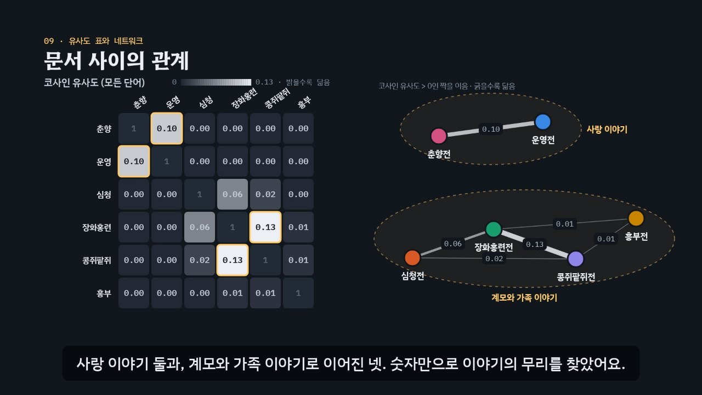

# 단어의 무게, 문서의 거리 — TF-IDF와 문서 유사도

> [DH 튜토리얼](../README.md) 모음의 한 꼭지입니다. 사이트 주소: `https://vadoro.github.io/dh_tutorials/tf-idf/`

여러 문서에서 **TF-IDF**를 계산해 문서마다 독특한 단어(특징어)를 뽑는 원리, 그리고 문서를 **벡터**로 바꿔 **코사인 유사도**와 **유클리드 거리**로 문서 사이의 관계를 재는 방법을 약 6분짜리 인터랙티브 모션그래픽으로 설명합니다. 예시는 우리 고전 소설 여섯 편(춘향전, 운영전, 심청전, 장화홍련전, 콩쥐팥쥐전, 흥부전)의 줄거리예요.



## 바로 보기

| 방법 | 설명 |
| --- | --- |
| **웹 주소** | `https://vadoro.github.io/dh_tutorials/tf-idf/` |
| **`index.html` 더블클릭** | 저장소를 내려받아 `tf-idf/index.html`을 열면 끝. 설치도, 서버도 필요 없어요. 인터넷이 없으면 글꼴만 기본 한글 글꼴로 바뀌어요. |

## 무엇을 배우나요

| 장 | 시각 | 내용 | 직접 해 보기 |
| --- | --- | --- | --- |
| 00 들어가며 | 0:00 | 고전 소설 여섯 편. 어떤 이야기가 닮았을까, 각 이야기만의 단어는? | 줄거리 읽기 (명사 표시) |
| 01 단어 가방 | 0:20 | 명사 고르기, 순서를 버리고 개수만 세기, 문서-단어 행렬 | 다른 문서의 단어 가방 |
| 02 TF · 단어 빈도 | 0:48 | 한 문서 안의 횟수. 모든 문서에 나오는 ‘이야기’의 문제 | 다른 문서의 TF |
| 03 DF와 IDF | 1:16 | DF, IDF = ln(N ÷ DF), IDF 곡선, 로그를 쓰는 까닭 | 단어를 골라 세 가지 IDF 공식 비교 |
| 04 TF-IDF | 1:56 | TF × IDF로 순위가 바뀌는 모습, 문서마다 특징어 | 다른 문서의 특징어 표 |
| 05 벡터로 바꾸기 | 2:38 | 65칸짜리 숫자 목록 = 65차원 화살표, 두 칸만 골라 평면에 | 평면에 그릴 두 단어 고르기 |
| 06 유클리드 거리 | 3:10 | 화살표 끝 사이 거리, 피타고라스, 세 번 이어 붙인 긴 춘향전이 가장 멀어지는 문제 | 두 문서의 거리 계산기 |
| 07 코사인 유사도 | 3:42 | 각도의 코사인, 같은 방향 1·직각 0, 내적 ÷ 길이의 곱 | 두 문서의 코사인과 함께 쓰는 단어 |
| 08 길이를 1로 | 4:22 | L2 정규화, 반지름 1인 원, 거리 = √(2 − 2 × 코사인) | 공식 확인 계산기 |
| 09 문서 사이의 관계 | 4:50 | 6 × 6 코사인 유사도 표, 함께 쓰는 단어, 문서 네트워크 | 표의 칸 누르기, 네트워크로 이을 기준 |
| 10 정리 | 5:32 | 다섯 단계 정리, scikit-learn 코드 | |

영상 아래에는 세 가지가 더 있어요.

- **놀이터** — 문서를 고치거나 새로 넣으면(`제목: 단어 단어 단어`, 한 줄에 하나) TF-IDF 상위 단어, 코사인 유사도·유클리드 거리 표, 가장 닮은 짝과 함께 쓰는 단어를 바로 다시 계산해요. IDF 공식 세 가지(교과서, scikit-learn 기본, `smooth_idf=False`)와 L2 정규화를 바꿔 볼 수 있고, 지금 설정과 같은 값을 내는 파이썬 코드를 보여 줘요. ‘+ 긴 춘향전’ 단추로 길이 문제를 직접 확인할 수 있어요.
- **퀴즈** — 열 문제. IDF가 가장 큰 단어 고르기, 유사도 표 읽기 같은 그림 문제가 섞여 있고, 답은 페이지의 계산으로 정해요.
- **용어집** — 단계별 용어와 공식, scikit-learn 기본값.

### 플레이어 조작

| 키 | 동작 |
| --- | --- |
| 스페이스 | 재생 / 일시정지 |
| ← → | 5초 뒤로 / 앞으로 |
| Shift + ← → | 이전 장 / 다음 장 |
| C | 자막 켜기 / 끄기 |
| V | 음성 해설 켜기 / 끄기 (자막을 다 읽을 때까지 영상이 기다려요) |
| F | 전체 화면 |

- 화면의 문서 카드를 누르면 그 문서가 단어 가방·TF·TF-IDF 장면에 나오고, 유사도 표의 칸을 누르면 두 문서가 함께 쓰는 단어를 보여 줘요. 조작하면 영상이 멈추고, 재생하면 이어서 봐요.
- 주소 끝에 `#c-장면이름`을 붙이면 그 장면에서 시작해요. 예: `index.html#c-cosine`

## 예시 문서와 결과

| 문서 | 특징어 (TF-IDF 상위 3) | 가장 닮은 문서 (코사인) |
| --- | --- | --- |
| 춘향전 | 춘향 · 몽룡 · 사또 | 운영전 0.10 (사랑, 이별) |
| 운영전 | 운영 · 김진사 · 사랑 | 춘향전 0.10 |
| 심청전 | 아버지 · 심청 · 눈 | 장화홍련전 0.06 (아버지) |
| 장화홍련전 | 자매 · 장화 · 홍련 | 콩쥐팥쥐전 0.13 (계모, 어머니, 구박, 벌) |
| 콩쥐팥쥐전 | 콩쥐 · 팥쥐 · 꽃신 | 장화홍련전 0.13 |
| 흥부전 | 제비 · 다리 · 박 | 콩쥐팥쥐전 0.01 (벌) |

교과서 공식(TF × ln(N ÷ DF))과 L2 정규화로 계산한 값입니다. 문서 여섯 편, 서로 다른 단어 65개(= 65차원). 점수가 같으면 그 문서에서 먼저 나온 단어를 앞에 둡니다.

## 무엇이 진짜 계산인가요

- **실제로 계산**: TF, DF, IDF(세 가지 공식), TF-IDF, L2 정규화, 코사인 유사도, 유클리드 거리, 함께 쓰는 단어의 기여도는 모두 `assets/js/corpus.js`가 페이지 안에서 계산해요. 영상의 숫자, 놀이터, 퀴즈 정답이 모두 이 계산에서 나와요. 자막 속 숫자와 계산이 어긋나면 콘솔에 경고가 떠요.
- **scikit-learn과 같은 값**: `examples/tfidf_classics.py`가 같은 문서로 numpy(교과서 공식)와 scikit-learn `TfidfVectorizer`(기본값)를 돌려 같은 숫자를 출력해요. 놀이터의 파이썬 코드도 페이지와 소수점 둘째 자리까지 같은 표를 만들어요.
- **설명을 위해 만든 것**: 줄거리는 짧게 쓴 요약이고, 명사는 형태소 분석기가 고른 결과를 흉내 내 손으로 표시했어요(`[대괄호]`). 실제 연구에서는 Kiwi, Okt 같은 분석기를 쓰세요. 놀이터의 ‘조사 떼기’는 어절 끝 글자만 보는 단순한 흉내예요.
- **평면 그림은 두 칸만**: 벡터 장면의 평면은 65칸 중 두 단어 칸만 골라 그린 그림이에요. 그래서 그림 속 각도·거리와 함께 65칸 모두로 계산한 진짜 값을 나란히 적었어요. 정규화 장면의 원은 ‘두 칸만 있다면’의 그림이고, 표의 길이·거리는 65칸 전체 값이에요.

```bash
pip install scikit-learn
python examples/tfidf_classics.py
```

## 폴더 구조

```
index.html              페이지 (영상 플레이어 · 직접 해 보기 · 놀이터 · 퀴즈 · 용어집)
assets/js/corpus.js     예시 문서와 진짜 계산 (TF, IDF, TF-IDF, 정규화, 코사인, 거리)
assets/js/scenes.js     영상 장면 11개, 장 목록과 자막
assets/js/app.js        플레이어, 직접 해 보기, 놀이터, 퀴즈, 영상 추출(DH_EXPORT)
examples/classics.tsv   예시 문서 (제목, 명사, [명사] 표시한 줄거리)
examples/tfidf_classics.py  같은 계산을 numpy·scikit-learn으로
video/                  자막 원고(SRT)
docs/poster.jpg         사이트 카드 그림
```

음성 해설과 퀴즈 화면은 사이트 공통 부품(`../shared/`)을 씁니다.

## 영상 다시 만들기

장면을 고쳤다면 저장소 루트에서 공통 렌더러로 다시 뽑아요(Node.js, ffmpeg, Playwright 필요).

```bash
node tools/render-video.cjs tf-idf                   # → tf-idf/video/tf-idf.mp4 + .srt (1920×1080, 30fps)
node tools/render-video.cjs tf-idf --frames 52,186   # 몇 장면만 그림으로 → frames/tf-idf/
node tools/render-video.cjs tf-idf --poster 327      # 카드 그림 → tf-idf/docs/poster.jpg
```

MP4는 사이트에 올리지 않아요. 방문자는 인터랙티브 페이지로 보게 하려는 것이에요. 수업 등에 직접 쓰려고 뽑은 MP4는 저장소에 커밋하지 말고, 보관하려면 '영상 보관' 워크플로([`.github/workflows/keep-videos.yml`](../.github/workflows/keep-videos.yml))로 주인만 보는 비공개 릴리스에 넣으세요.

`index.html#export`로 열면 페이지가 추출 모드가 되어 정해진 시각의 장면을 그대로 그려요. 그림은 시각과 상태만으로 정해지므로 같은 시각이면 언제나 같은 그림이 나와요.

## 참고

- scikit-learn, [Tf–idf term weighting](https://scikit-learn.org/stable/modules/feature_extraction.html#tfidf-term-weighting)
- Manning, Raghavan, Schütze, *Introduction to Information Retrieval*, 6장 [tf-idf weighting](https://nlp.stanford.edu/IR-book/html/htmledition/tf-idf-weighting-1.html)
- Karen Spärck Jones (1972), “A statistical interpretation of term specificity and its application in retrieval”, *Journal of Documentation* 28(1)
