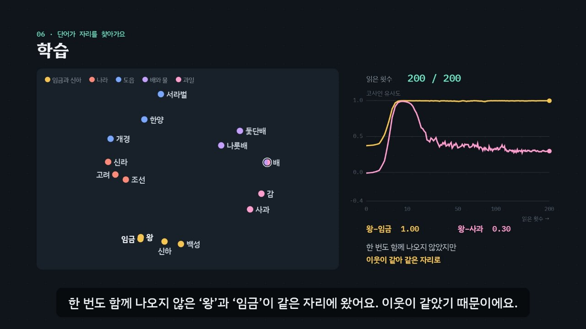

# 단어를 지도 위에 — 워드 임베딩의 원리

> [DH 튜토리얼](../README.md) 모음의 한 꼭지입니다. 사이트 주소: `https://vadoro.github.io/dh_tutorials/word-embedding/`

단어를 짧은 숫자 목록(벡터)으로 바꿔, 뜻이 비슷한 단어를 가까이 두는 **워드 임베딩**(word embedding)의 원리를 약 6분짜리 인터랙티브 모션그래픽으로 설명합니다. 옛 나라와 도읍, 배와 과일 이야기가 담긴 짧은 문장 52개로 따라가요.

- **원-핫 인코딩**에서 출발해 왜 다른 방법이 필요한지
- **분포 가설**: 단어는 이웃을 보면 뜻을 알 수 있다
- **함께 나오는 단어 세기**(창, 동시 출현 행렬)
- **word2vec**: 스킵그램과 네거티브 샘플링으로 짧은 벡터 배우기
- **가까운 단어와 유추**: 조선 : 한양 = 고려 : ?
- **한계와 활용**: 다의어 ‘배’, 편향, 시드에 따른 흔들림, 뜻의 변화, 문맥 임베딩



## 바로 보기

| 방법 | 설명 |
| --- | --- |
| **웹 주소** | `https://vadoro.github.io/dh_tutorials/word-embedding/` |
| **`index.html` 더블클릭** | 저장소를 내려받아 `word-embedding/index.html`을 열면 끝. 설치도, 서버도 필요 없어요. 인터넷이 없으면 글꼴만 기본 한글 글꼴로 바뀌어요. |

## 무엇을 배우나요

| 장 | 시각 | 내용 | 직접 해 보기 |
| --- | --- | --- | --- |
| 00 들어가며 | 0:00 | 단어를 숫자로, 단어 하나 = 숫자 8개, 단어 지도 | 단어를 골라 8칸과 가까운 단어 보기 |
| 01 원-핫 인코딩 | 0:20 | 칸 59개 중 하나만 1, 서로 다른 단어는 모두 코사인 0, 단어 10만 개면 칸 10만 개 | 원-핫과 임베딩의 유사도 비교 |
| 02 분포 가설 | 0:46 | Firth(1957)의 말, 빈칸에 ‘왕’과 ‘임금’이 모두 들어감 | 단어를 숨기고 같은 자리에 올 단어 찾기 |
| 03 함께 나오는 단어 세기 | 1:14 | 낱말 원형, 창 크기 2, 동시 출현 행렬, 한 번도 함께 안 나온 ‘왕’·‘임금’의 코사인 0.96 | 창 크기 바꾸기 |
| 04 짧고 촘촘한 벡터 | 1:58 | 59칸 → 8칸, 숫자 하나하나에는 이름이 없음 | 두 단어의 8칸 비교 |
| 05 word2vec | 2:26 | 스킵그램과 CBOW, 내적, 당기기와 밀어내기(네거티브 샘플링), 실제로 뽑힌 가짜 이웃 | 실제 학습 걸음을 하나씩 보기 |
| 06 학습 | 3:16 | 200번 읽는 동안 지도가 바뀌는 모습, 처음엔 한쪽으로 쏠렸다 갈라짐, 왕–임금 1.00 · 왕–사과 0.30 | 읽은 횟수 막대로 지도 되감기 |
| 07 가까운 단어와 유추 | 3:56 | ‘한양’과 가까운 단어, 한양 − 조선 + 고려 ≈ 개경, king − man + woman, 틀리는 유추 | 가까운 단어와 유추 직접 계산 |
| 08 한계 | 4:38 | 다의어 ‘배’, 말뭉치의 고정관념, 시드만 바꿔도 흔들리는 결과 | 시드 바꿔 다시 학습 |
| 09 디지털 인문학에서 | 5:16 | 뜻의 변화, 개념의 축, 문맥 임베딩(BERT) | 내 연구에 쓰는 법 |
| 10 정리 | 5:52 | 다섯 단계 정리, gensim 코드 | 실제 연구의 설정값 |

영상 아래에는 세 가지가 더 있어요.

- **놀이터** — 말뭉치를 고치거나 내 글을 넣고(한 줄에 한 문장, 어절 끝 조사 떼기 선택) 설정을 바꾸면 이 페이지가 word2vec을 바로 다시 학습해요.
  - 설정: 벡터 길이, 창 크기, 가짜 이웃 수, 읽는 횟수, 시드
  - 결과: 가까운 단어(명사만 보기), 유추, 두 단어 비교(임베딩 유사도 · 함께 나온 횟수 · 동시 출현 코사인), 이웃 세기, 단어 지도(PCA)
  - 지금 설정과 같은 gensim 코드
- **퀴즈** — 열 문제. 창 안의 이웃 고르기, 지도에서 ‘배’ 찾기 같은 그림 문제가 섞여 있고, 답은 페이지의 계산으로 정해요.
- **용어집** — 기본, 세기 · 분포 가설, word2vec(gensim 기본값), 활용과 한계.

### 플레이어 조작

| 키 | 동작 |
| --- | --- |
| 스페이스 | 재생 / 일시정지 |
| ← → | 5초 뒤로 / 앞으로 |
| Shift + ← → | 이전 장 / 다음 장 |
| C | 자막 켜기 / 끄기 |
| V | 음성 해설 켜기 / 끄기 (자막을 다 읽을 때까지 영상이 기다려요) |
| F | 전체 화면 |

- 화면의 단어 점이나 가까운 단어 목록을 누르면 그 단어가 ‘직접 해 보기’에 들어가요. 조작하면 영상이 멈추고, 재생하면 이어서 봐요.
- 주소 끝에 `#c-장면이름`을 붙이면 그 장면에서 시작해요. 예: `index.html#c-use`

## 예시 말뭉치와 결과

말뭉치는 52문장, 단어 59개, 낱말 184개예요. 왕·임금, 세 나라와 도읍(조선–한양, 고려–개경, 신라–서라벌)과 세운 사람·궁궐, 배와 과일 이야기로 이뤄져 있어요. 설정은 벡터 길이 8, 창 크기 2, 가짜 이웃 5개, 200번 읽기, 학습률 0.05 → 0.0001, 시드 7이에요.

| 무엇 | 결과 |
| --- | --- |
| 동시 출현 줄의 코사인 | 왕–임금 0.96 (함께 나온 횟수 0), 왕–사과 0 |
| 학습 뒤 유사도 | 왕–임금 1.00, 왕–사과 0.30 (10번 읽었을 때는 0.98까지 올랐다가 내려옴) |
| ‘한양’과 가까운 단어 | 개경 0.90, 서라벌 0.87, 궁궐 0.71, 도읍 0.69 (명사만) |
| ‘배’와 가까운 단어 | 돛단배 0.90, 감 0.87, 사과 0.81, 나룻배 0.78 — 두 뜻이 섞임 |
| 조선 : 한양 = 고려 : ? | 개경 0.93 (질문의 세 단어는 빼고 찾음) |
| 신라 : 서라벌 = 고려 : ? | 한양 0.93 (틀림, 개경은 0.81) |
| 시드에 따른 ‘신하’의 이웃 | 시드 7: 경복궁·만월대·백성, 시드 1: 백성·나라·만월대 |

## 무엇이 진짜 계산인가요

- **실제로 계산**: 다음은 모두 `assets/js/embedding.js`가 페이지 안에서 계산해요. 영상의 숫자, 놀이터, 퀴즈 정답이 모두 이 계산에서 나오고, 자막 속 숫자와 계산이 어긋나면 콘솔에 경고가 떠요.
  - 원-핫 벡터, 동시 출현 횟수와 코사인 유사도
  - word2vec 스킵그램 + 네거티브 샘플링 학습(읽을 때마다 벡터를 저장해 학습 장면을 그림)
  - 가까운 단어, 유추, PCA 2차원 지도
- **파이썬과 같은 값**: `examples/embedding_basics.py`는 같은 계산을 순서까지 그대로 옮겨서, 페이지와 소수점 열네 자리까지 같은 벡터를 만들어요(시드를 고정한 mulberry32 난수).
- **gensim과 같은 경향**: gensim 4 `Word2Vec(sg=1, negative=5, sample=0, shrink_windows=False, …)`으로 학습해도 왕–임금 1.00, 조선 : 한양 = 고려 : 개경 같은 결과가 나와요. 난수 쓰는 방법이 달라 숫자는 조금 달라요. 놀이터의 코드도 같은 설정이에요.
- **페이지의 word2vec이 줄인 것**: word2vec(Mikolov 외, 2013)의 방법을 따르되, 창 크기를 무작위로 줄이지 않고(`shrink_windows`), 흔한 낱말 덜어 내기(`sample`)도 하지 않아요. 말뭉치가 작아 학습률(0.05)과 읽는 횟수(200)를 키웠어요.
- **설명을 위해 만든 것**:
  - **말뭉치**는 설명을 위해 만든 52문장이에요. 결과를 일반적인 사실로 읽으면 안 돼요.
  - **낱말 원형**은 형태소 분석기가 고른 것처럼 손으로 적었고, ‘있다’ 같은 흔한 말은 뺐어요. 놀이터의 ‘조사 떼기’는 어절 끝 글자만 보는 단순한 흉내예요.
  - **내적을 2차원 화살표로 그린 장면**(05장)은 설명용 그림이에요. 실제 벡터는 8차원이고, 장면에 적은 가짜 이웃은 실제 학습 두 번째 걸음에서 뽑힌 단어예요.
  - **2차원 지도**는 8차원을 PCA로 줄인 대략의 모습이라 일부 정보가 사라져요. 그래서 유추는 지도 대신 8칸 벡터의 셈으로 보여 줘요.
  - **뜻의 변화·개념의 축·문맥 임베딩 카드**(09장)는 연구를 소개할 뿐 이 페이지가 계산하지 않아요.

```bash
python examples/embedding_basics.py      # 설치할 것 없음
pip install gensim                       # 맨 아래 gensim 비교까지 보려면
```

## 폴더 구조

```
index.html                   페이지 (영상 플레이어 · 직접 해 보기 · 놀이터 · 퀴즈 · 용어집)
assets/js/embedding.js       예시 말뭉치와 진짜 계산 (동시 출현, word2vec 학습, 가까운 단어, 유추, PCA)
assets/js/scenes.js          영상 장면 11개, 장 목록과 자막
assets/js/app.js             플레이어, 직접 해 보기, 놀이터, 퀴즈, 영상 추출(DH_EXPORT)
examples/corpus.tsv          예시 말뭉치 (원문, 낱말 원형)
examples/embedding_basics.py 같은 계산을 파이썬으로 (+ gensim 비교)
video/                       자막 원고(SRT)
docs/poster.jpg              사이트 카드 그림
```

음성 해설과 퀴즈 화면은 사이트 공통 부품(`../shared/`)을 씁니다.

## 영상 다시 만들기

장면을 고쳤다면 저장소 루트에서 공통 렌더러로 다시 뽑아요(Node.js, ffmpeg, Playwright 필요).

```bash
node tools/render-video.cjs word-embedding                    # → word-embedding/video/word-embedding.mp4 + .srt (1920×1080, 30fps)
node tools/render-video.cjs word-embedding --frames 98,210    # 몇 장면만 그림으로 → frames/word-embedding/
node tools/render-video.cjs word-embedding --poster 229       # 카드 그림 → word-embedding/docs/poster.jpg
```

MP4는 사이트에 올리지 않아요. 방문자는 인터랙티브 페이지로 보게 하려는 것이에요. 수업 등에 직접 쓰려고 뽑은 MP4는 저장소에 커밋하지 말고, 보관하려면 '영상 보관' 워크플로([`.github/workflows/keep-videos.yml`](../.github/workflows/keep-videos.yml))로 주인만 보는 비공개 릴리스에 넣으세요.

`index.html#export`로 열면 페이지가 추출 모드가 되어 정해진 시각의 장면을 그대로 그려요. 그림은 시각과 상태만으로 정해지므로 같은 시각이면 언제나 같은 그림이 나와요.

## 참고

- Tomas Mikolov 외 (2013), “Efficient Estimation of Word Representations in Vector Space”; “Distributed Representations of Words and Phrases and their Compositionality”, *NeurIPS*
- Tomas Mikolov, Wen-tau Yih, Geoffrey Zweig (2013), “Linguistic Regularities in Continuous Space Word Representations”, *NAACL*
- J. R. Firth (1957), “A Synopsis of Linguistic Theory 1930–1955”; Zellig Harris (1954), “Distributional Structure”
- Omer Levy, Yoav Goldberg (2014), “Neural Word Embedding as Implicit Matrix Factorization”, *NeurIPS*
- William L. Hamilton, Jure Leskovec, Dan Jurafsky (2016), “Diachronic Word Embeddings Reveal Statistical Laws of Semantic Change”, *ACL*
- Tolga Bolukbasi 외 (2016), “Man is to Computer Programmer as Woman is to Homemaker? Debiasing Word Embeddings”, *NeurIPS*
- Aylin Caliskan, Joanna J. Bryson, Arvind Narayanan (2017), “Semantics derived automatically from language corpora contain human-like biases”, *Science* 356
- Austin C. Kozlowski, Matt Taddy, James A. Evans (2019), “The Geometry of Culture: Analyzing the Meanings of Class through Word Embeddings”, *American Sociological Review* 84(5)
- gensim, [Word2Vec](https://radimrehurek.com/gensim/models/word2vec.html)
